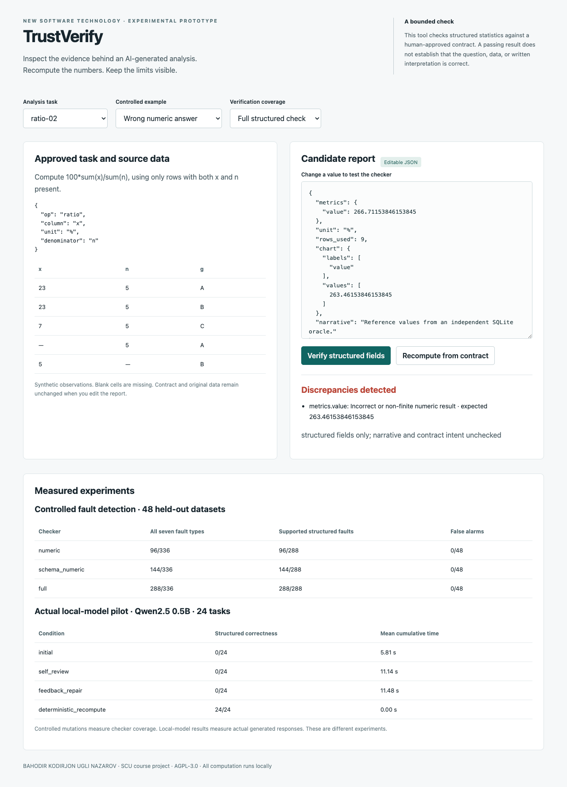
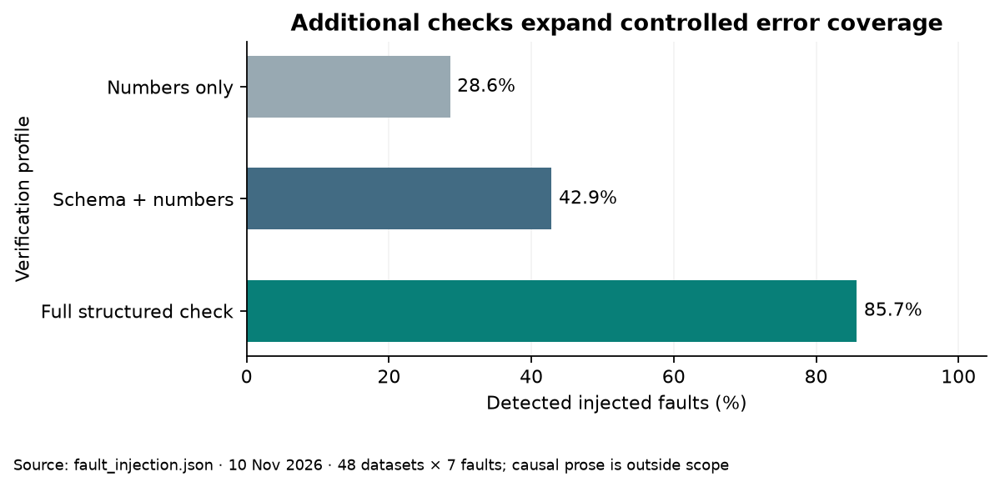
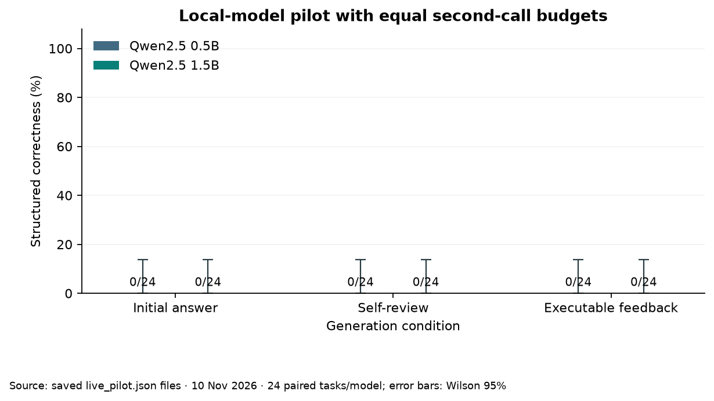
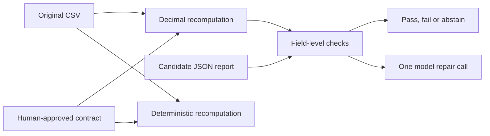

# TrustVerify

**Trust but Verify: Detecting and Repairing Errors in AI-Generated Data Analysis**

An individual New Software Technology course project at Sichuan University by
**BAHODIR KODIRJON UGLI NAZAROV**. Instructor: Dr. Hu Dasha.

TrustVerify checks selected structured claims against a human-approved analysis contract.
It recomputes numbers and checks units, valid-row counts and chart data. A passing check
does **not** certify the narrative, data quality, choice of analysis or entire report.



## Run locally

Python 3.10+ is sufficient. The core, tests and demo have **no third-party dependencies**.

```bash
git clone https://github.com/naazzarov/trustverify-ai-analysis.git
cd trustverify-ai-analysis
python3 -m unittest discover -s tests -v
python3 -m trustverify.server
```

Open [the local demo](http://127.0.0.1:8765). Choose a fault, verify the report, then recompute.
Try the **unsupported causal prose** example: its structured values pass while its causal
assertion remains unsupported. This is an intentional demonstration of the tool's boundary.

## Project deliverables

- [SCU-format final report PDF](paper/main.pdf) and [editable LaTeX source](paper/main.tex)
- [Editable presentation](presentation/TrustVerify-final.pptx) and [speaker/demo guide](docs/presentation_guide.md)
- [Project description](docs/project_description.md)
- [Research protocol](docs/protocol.md), [original pilot protocol](docs/protocol_v1.md) and [dataset card](docs/dataset_card.md)
- [Course rubric evidence map](docs/course_alignment.md)
- [Actual recorded results](results/) and raw model requests/responses in `results/raw/` and `results/qwen-1.5b/raw/`
- [Reliability boundaries and AI disclosure](docs/limitations.md)

The public report omits the student ID. College and program fields require author confirmation.
The submission copy supplied separately contains the provided student ID. No grade or instructor
approval is implied by this repository.

## Measured results

<!-- RESULTS_START -->
Controlled fault injection: full checking detects **288/336 faults (85.7%)**, including **288/288 supported structured faults**, with **0/48 clean-report false alarms**. It misses all **48 causal-prose faults**, which are outside its scope. These are designed mutations, not natural model error frequencies.

| Actual local model | Initial | Self-review | Executable-feedback repair |
|---|---:|---:|---:|
| Qwen2.5 0.5B | 0/24 | 0/24 | 0/24 |
| Qwen2.5 1.5B | 0/24 | 0/24 | 0/24 |

The table reports **full structured correctness**, including chart data and units. Deterministic recomputation reaches **24/24** separately and is not counted as LLM improvement.

The model results reveal a floor effect on the full-report endpoint. [Exploratory numeric-only diagnostics](results/secondary_diagnostics.json) distinguish correct arithmetic from complete report compliance. All failures are retained. Wilson intervals, paired outcomes, timing and limitations appear in the report.

For the 1.5B model, correct numeric mappings increase from **0/24 with self-review** to **19/24 with executable feedback**. This is an exploratory field-level result; the full reports still fail.
<!-- RESULTS_END -->





## How verification works



The approved contract specifies the operation, columns and unit. Supported operations are
sum, mean, weighted mean, ratio of sums as percent, group sum and first-to-last percent change.
The independent SQLite gold file is used only by the evaluator, never by the production checker.
Feedback can reveal recomputed expected values; that is external computational information.

No model-generated code is executed. This implementation accepts structured reports and
supports only the documented operations.

## Reproduce the experiments

```bash
# No network or model needed:
python3 -m trustverify.cli generate
python3 -m trustverify.cli benchmark
python3 scripts/check_results.py
```

Data are synthetic. There are 12 development and 48 test datasets, split by independent
dataset variants. The actual-model pilot uses 24 test tasks per model. Controlled errors
and real model failures have separate denominators and must not be merged.

To regenerate the actual local-model calls, install [Ollama](https://ollama.com/) separately,
start its local service, and run:

```bash
ollama pull qwen2.5:0.5b
ollama pull qwen2.5:1.5b
python3 -m trustverify.live
python3 -m trustverify.live --model qwen2.5:1.5b --output results/qwen-1.5b
python3 scripts/summarize.py
```

Existing completed calls are reused only when their request hashes match. For a completely
new run, choose a new `--output` directory instead of overwriting the published evidence.
Model digests, runtime options, prompts, raw responses, latency and token counts are recorded.
Different hardware, runtime versions or model digests can change generation and timing.

Both review branches start from the same initial response and get one additional call with
the same token limit. The second model is explicitly a capacity-check amendment after the
first pilot, with unchanged prompts. It is not a separately preregistered replication.

## Check a custom report

Create a contract and candidate report using the schema in [the project description](docs/project_description.md).
For example, the approved contract for a sum of column `x` is:

```json
{"op": "sum", "column": "x", "unit": "points"}
```

The candidate report has `metrics`, `unit`, `rows_used`, `chart` and `narrative` fields.
For a scalar metric use key `value`, and chart labels `["value"]` with matching values.

```bash
python3 -m trustverify.cli verify --csv observations.csv --spec contract.json --report candidate.json
python3 -m trustverify.cli repair --csv observations.csv --spec contract.json --report candidate.json
```

Verification exits 0 for a pass, 1 for a failed check or abstention, and 2 for invalid inputs.
Repair is deterministic computation, not model self-correction. Blank required observations
are excluded using complete-case rules. Numeric tolerance is 1e-6 absolute or relative.

## Figures, report and slides

Figure regeneration requires Python 3.11+ and the optional plotting dependencies:

```bash
python3 -m venv .venv
.venv/bin/python -m pip install -r requirements-figures.txt
.venv/bin/python scripts/make_figures.py
```

Compile the report using the supplied template's XeLaTeX workflow:

```bash
cd paper
xelatex main
bibtex main
xelatex main
xelatex main
```

The delivered PDF was compiled with Tectonic's XeTeX-based engine and checked visually.
The SCU cover, A4 geometry, bilingual abstracts and GB/T 7714 references are retained.
The editable slide deck can be opened directly in PowerPoint. Its authoring source uses
Codex's bundled `@oai/artifact-tool`, which is not a public npm dependency. Rebuilding the
PPTX therefore requires that runtime plus `PRESENTATION_SKILL_DIR`, `RUNTIME_NODE_MODULES` and `RUNTIME_PYTHON`.
The application, experiments, figures and manuscript do not depend on that authoring runtime.

## Research foundations

- Jing et al., [DSBench](https://arxiv.org/abs/2409.07703): realistic data-science-agent evaluation.
- Madaan et al., [Self-Refine](https://arxiv.org/abs/2303.17651): iterative improvement with model feedback.
- Huang et al., [Large Language Models Cannot Self-Correct Reasoning Yet](https://arxiv.org/abs/2310.01798): limitations of intrinsic reasoning self-correction in their tested settings.
- [Qwen2.5 release](https://qwenlm.github.io/blog/qwen2.5/) and [Ollama chat API](https://docs.ollama.com/api/chat): model and local-inference provenance.

These works motivate the design. Their benchmark scores are not directly comparable with this study.

## Licence and attribution

[AGPL-3.0-only](LICENSE). The supplied template's actual licence file is AGPL-3.0, despite
the GPL wording in its README. Its licence and upstream attribution are preserved in
[third-party notices](THIRD_PARTY_NOTICES.md). Model weights and lecturer-owned slides
are not redistributed. University branding does not imply endorsement.

Codex assisted with code, experiment orchestration, writing and layout. All reported
model responses are actual logged calls. The author should inspect, reproduce and be
able to explain the work before submission and presentation.
