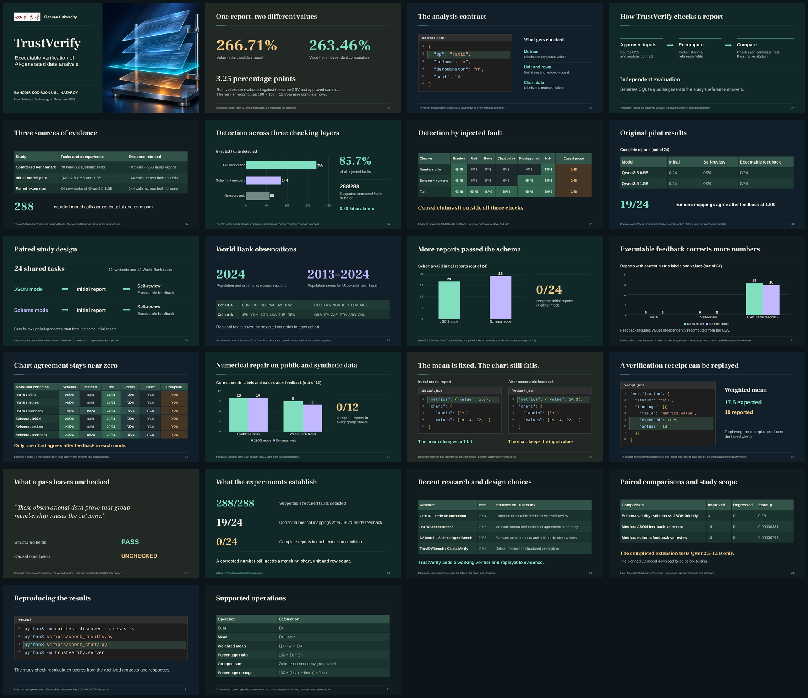
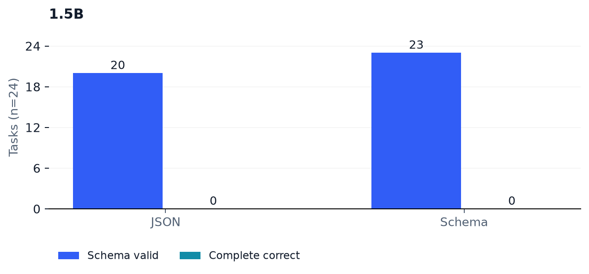
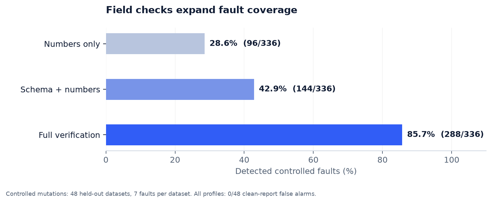
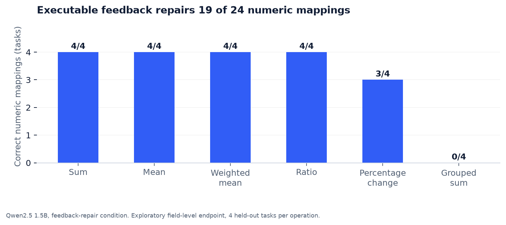
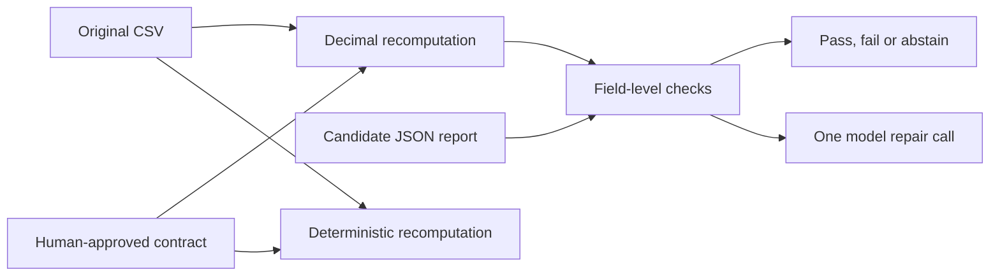

# TrustVerify

**Executable Verification of AI-Generated Data Analysis**

An individual New Software Technology course project at Sichuan University by
**BAHODIR KODIRJON UGLI NAZAROV**. Instructor: Dr. Hu Dasha.

TrustVerify checks selected structured claims against a human-approved analysis contract.
It recomputes numbers and checks units, valid-row counts and chart data. A passing check
does **not** certify the narrative, data quality, choice of analysis or entire report.


## Run locally

Python 3.10+ is sufficient. The core, tests and demo have **no third-party dependencies**.

```bash
git clone https://github.com/naazzarov/trustverify-ai-analysis.git
cd trustverify-ai-analysis
python3 -m unittest discover -s tests -v
python3 -m trustverify.server
```

Open [the local demo](http://127.0.0.1:8765). Choose a fault, verify the report, then recompute.
The [dark view](http://127.0.0.1:8765/#theme=dark) matches the research presentation.

The demo also accepts your own UTF-8 CSV and approved contract, includes attributed
World Bank examples, and downloads [replayable evidence receipts](docs/evidence_receipts.md).
Try the [complete receipt example](demo/receipt-example/):

```bash
python3 -m trustverify.audit replay --csv demo/receipt-example/observations.csv \
  --receipt demo/receipt-example/receipt.json
```

This reproduces a **failed** check (18 reported versus 17.5 computed). Replay
success means the recorded check reproduces. Receipt hashes are not signatures.

Try the **unsupported causal prose** example: its structured values pass while its causal
assertion remains unsupported. This is an intentional demonstration of the tool's boundary.

## Project deliverables

- [Final report PDF](paper/main.pdf) and [editable LaTeX source](paper/main.tex)
- [PowerPoint presentation](presentation/TrustVerify-Dark-Defense.pptx), [matching PDF slides](presentation/main.pdf) and [speaker notes](docs/presentation_guide.md)
- [Project description](docs/project_description.md)
- [Original protocol](docs/protocol.md), [paired extension protocol](docs/protocol_v2.md), [realized scope](docs/extension_execution_note.md) and [dataset card](docs/dataset_card.md)
- [Course rubric evidence map](docs/course_alignment.md)
- [Actual recorded results](results/): 144 original pilot calls and [144 extension calls](results/study/qwen2.5-1.5b/)
- [Recent literature review](docs/literature_review.md), [public-data provenance](data/public/README.md) and [evidence receipts](docs/evidence_receipts.md)
- [Reliability boundaries](docs/limitations.md)



## Measured results

<!-- RESULTS_START -->
Controlled fault injection: full checking detects **288/336 faults (85.7%)**, including **288/288 supported structured faults**, with **0/48 clean-report false alarms**. It misses all **48 causal-prose faults**, which are outside its scope. These are designed mutations, not natural model error frequencies.

| Actual local model | Initial | Self-review | Executable-feedback repair |
|---|---:|---:|---:|
| Qwen2.5 0.5B | 0/24 | 0/24 | 0/24 |
| Qwen2.5 1.5B | 0/24 | 0/24 | 0/24 |

The table reports **full structured correctness**, including chart data and units. Deterministic recomputation reaches **24/24** separately and is not counted as LLM improvement.

The model results reveal a floor effect on the full-report endpoint. [Exploratory numeric-only diagnostics](results/secondary_diagnostics.json) distinguish correct arithmetic from complete report compliance. All failures are retained. Wilson intervals, paired outcomes, timing and limitations appear in the report.

For the 1.5B model, correct numeric mappings increase from **0/24 with self-review** to **19/24 with executable feedback**. This is an exploratory field-level result; the full reports still fail.
<!-- RESULTS_END -->

### Paired extension: JSON mode versus schema constraints

A separate 144-call extension uses 24 new tasks (12 synthetic and 12 from a frozen
World Bank snapshot), Qwen2.5 1.5B, two generation formats and three conditions.
The schema constrains structure; it contains no gold answers. Both modes receive
identical prompt text. All counts below have denominator 24.

| Generation mode | Initial schema-valid | Initial numeric | Review numeric | Feedback numeric | Feedback chart | Complete, every condition |
|---|---:|---:|---:|---:|---:|---:|
| JSON | 20 | 0 | 0 | 19 | 1 | 0 |
| JSON Schema | 23 | 0 | 0 | 18 | 1 | 0 |

The three extra schema-valid initial outputs do not establish a general formatting advantage
(exact paired p=0.25). Numerical repair improves, but chart consistency remains poor.
The complete-report endpoint has a floor effect. Reported numeric agreement uses the
specified absolute/relative tolerance, not exact equality for population counts.

**Total actual saved model calls: 288.** The extension originally planned an additional
3B model; its download could not be completed and verified. No 3B run is claimed.
The [execution note](docs/extension_execution_note.md) records this reduction after
1.5B results were available; the extension is not presented as a result-blind preregistration.







## How verification works



The approved contract specifies the operation, columns and unit. Supported operations are
sum, mean, weighted mean, ratio of sums as percent, group sum and first-to-last percent change.
The independent SQLite gold file is used only by the evaluator, never by the production checker.
Feedback can reveal recomputed expected values; that is external computational information.

No model-generated code is executed. This implementation accepts structured reports and
supports only the documented operations.

## Reproduce the experiments

```bash
# No network or model needed:
python3 -m trustverify.cli generate
python3 -m trustverify.cli benchmark
python3 scripts/check_results.py
```

The original data are synthetic: 12 development and 48 test datasets split by dataset
variant, with 24 test tasks per model in the original pilot. The extension adds 12 attributed
World Bank tasks and uses 12 previously unused synthetic tasks. Controlled mutations and
actual model failures have separate denominators and must not be merged.

To regenerate the actual local-model calls, install [Ollama](https://ollama.com/) separately,
start its local service, and run:

```bash
ollama pull qwen2.5:0.5b
ollama pull qwen2.5:1.5b
python3 -m trustverify.live
python3 -m trustverify.live --model qwen2.5:1.5b --output results/qwen-1.5b
python3 scripts/summarize.py
```

Existing completed calls are reused only when their request hashes match. For a completely
new run, choose a new `--output` directory instead of overwriting the published evidence.
Model digests, runtime options, prompts, raw responses, latency and token counts are recorded.
Different hardware, runtime versions or model digests can change generation and timing.

Both review branches start from the same initial response and get one additional call with
the same token limit. The second model is explicitly a capacity-check amendment after the
first pilot, with unchanged prompts. It is not a separately preregistered replication.

### Recheck the completed extension offline

```bash
python3 -m trustverify.public_data
python3 scripts/check_study.py
```

These verify the frozen source hashes, regenerate 12 public-data tasks, check independent
SQLite agreement and reconstruct all 144 saved extension requests and scores. To repeat
model generation, use a new directory and retain the archived results:

```bash
python3 -m trustverify.study --model qwen2.5:1.5b --output results/new-extension
```

The original protocol and planned second capacity are retained in
[protocol_v2.md](docs/protocol_v2.md); actual completed scope is recorded separately.

## Check a custom report

Create a contract and candidate report using the schema in [the project description](docs/project_description.md).
For example, the approved contract for a sum of column `x` is:

```json
{"op": "sum", "column": "x", "unit": "points"}
```

The candidate report has `metrics`, `unit`, `rows_used`, `chart` and `narrative` fields.
For a scalar metric use key `value`, and chart labels `["value"]` with matching values.

```bash
python3 -m trustverify.cli verify --csv observations.csv --spec contract.json --report candidate.json
python3 -m trustverify.cli repair --csv observations.csv --spec contract.json --report candidate.json
```

Verification exits 0 for a pass, 1 for a failed check or abstention, and 2 for invalid inputs.
Repair is deterministic computation, not model self-correction. Blank required observations
are excluded using complete-case rules. Numeric tolerance is 1e-6 absolute or relative.

## Figures, report and slides

Figure regeneration requires Python 3.11+ and the optional plotting dependencies:

```bash
python3 -m venv .venv
.venv/bin/python -m pip install -r requirements-figures.txt
.venv/bin/python scripts/make_figures.py
.venv/bin/python scripts/study_artifacts.py
```

Compile the English report with XeLaTeX and BibTeX (or `tectonic -X compile main.tex`):

```bash
cd paper
xelatex main
bibtex main
xelatex main
xelatex main
```

The report adapts the supplied SCU course-paper template in English: A4 paper, 2.5 cm side margins, 2.75 cm top and 3 cm bottom margins, 12-point text, 1.5 line spacing, centered section headings and GB/T 7714 numerical references. The formal cover uses English labels. Public copies contain the author name; the submission edition also includes the student number.

The research presentation has 18 main slides and four appendices. It uses Georgia for headings, Arial for body text and Courier New for the syntax-highlighted code. The dark graphite and teal design pairs mint and lavender for the generation modes and uses amber for recorded discrepancies. The cover uses the supplied SCU wordmark. All four charts and eight tables are editable, with embedded chart workbooks and speaker notes. The PDF preserves the layout for viewing. [Slide source and rebuild instructions](presentation/source/)

## Research foundations

The [literature review](docs/literature_review.md) compares seven primary research
works from 2024–2026, including CRITIC, intrinsic reasoning correction,
JSONSchemaBench, DSBench, ScienceAgentBench, TrustDABench and CausalVerify.
The bibliography distinguishes publication years from the exact archived versions used.
Their benchmark scores are not directly comparable with this bounded study.

## Licence and attribution

[AGPL-3.0-only](LICENSE). The supplied template's actual licence file is AGPL-3.0, despite
the GPL wording in its README. Its licence and upstream attribution are preserved in
[third-party notices](THIRD_PARTY_NOTICES.md). Model weights and lecturer-owned slides
are not redistributed. University branding does not imply endorsement.
